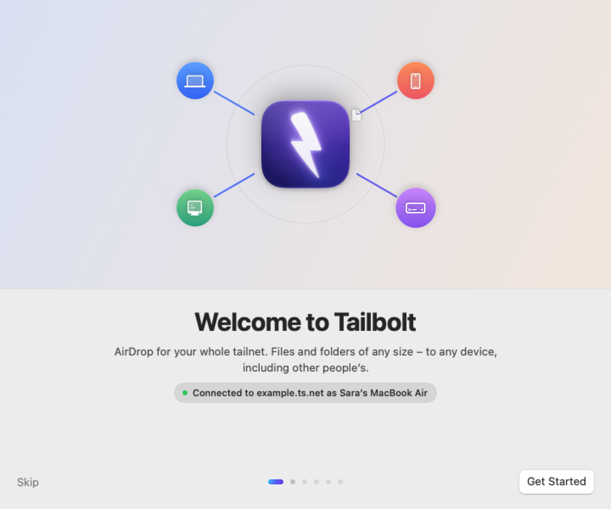
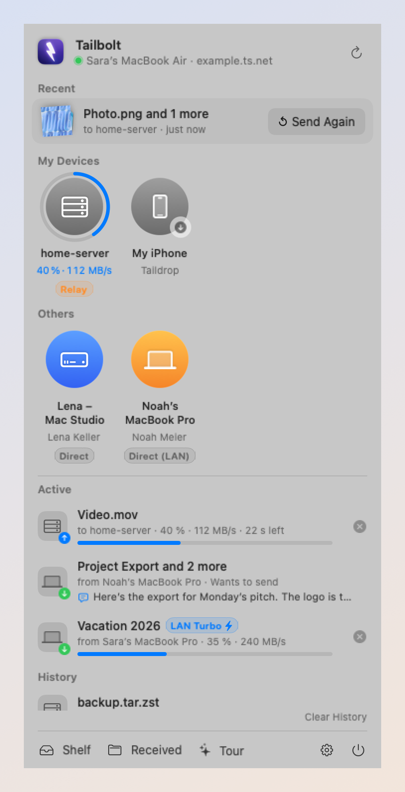
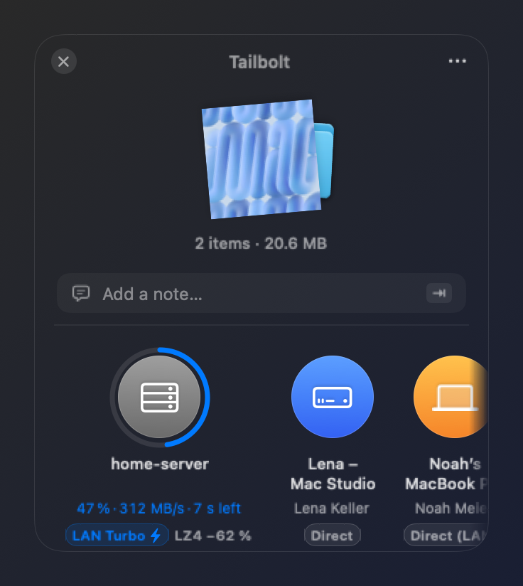
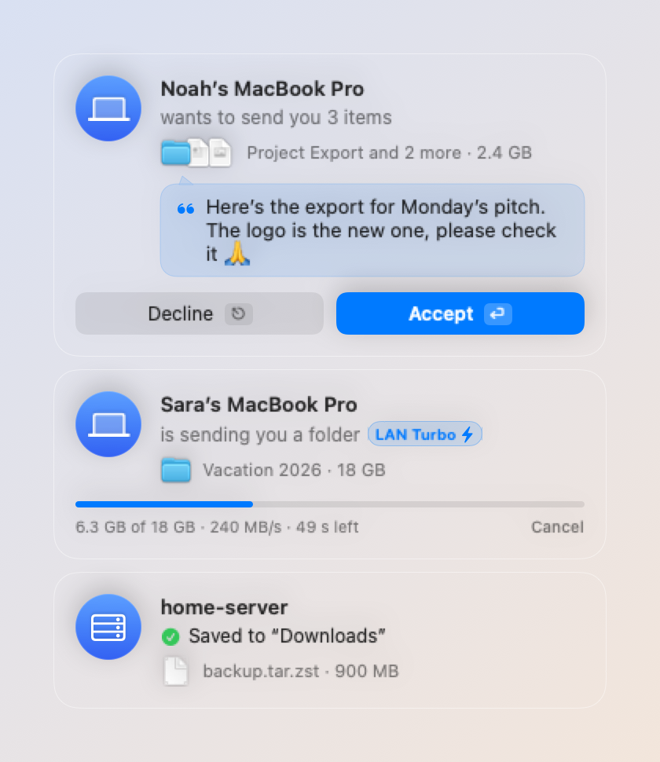
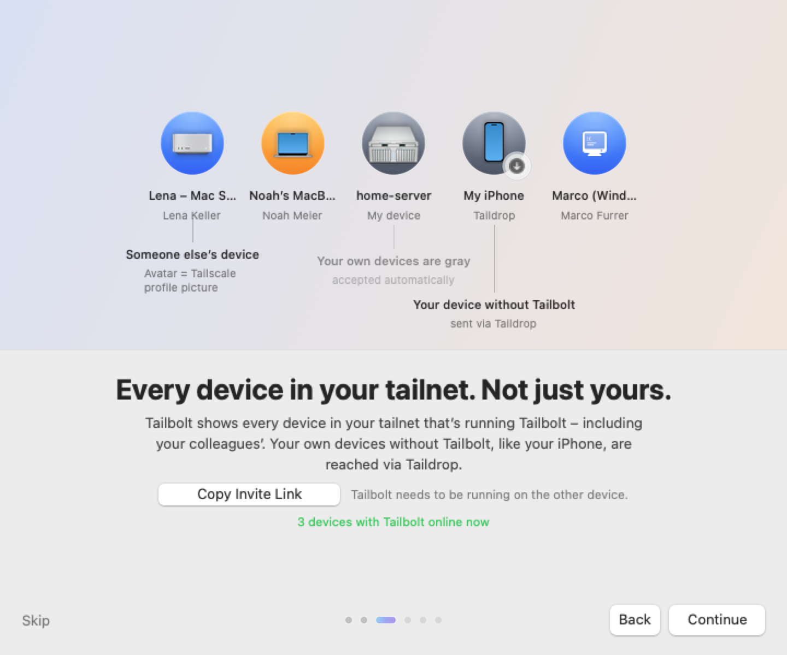
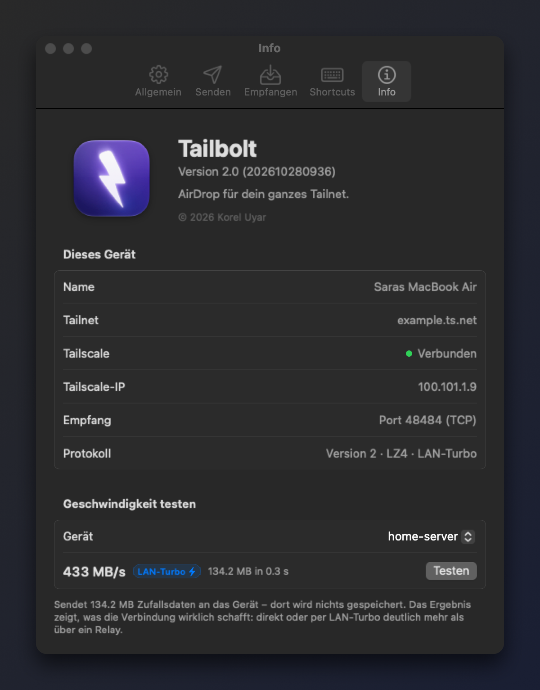

# Tailbolt

**AirDrop for your whole tailnet.** Send files and folders of **any size** to **any** device in your
[Tailscale](https://tailscale.com) network — your own and other people's — as fast as the wire allows.

<p align="center">
  
</p>

<p align="center">
  
  &nbsp;
  
  &nbsp;
  
</p>

Taildrop only sends between *your own* devices. Tailbolt sends to everyone in the tailnet — a colleague's
Mac included — with a Dropover-style shelf, global shortcuts and a LAN fast path.

macOS menu-bar app (macOS 14+, Apple silicon and Intel), in English and German (Settings → General → Language). The engine
(`TailboltCore`) is plain Foundation + POSIX sockets and is meant to be reused for Linux/Windows/iOS; the
wire protocol is documented in [PROTOCOL.md](PROTOCOL.md).

Until 2.0 the app was called *Tailbeam*; the name was dropped because an unrelated Go CLI of that name
(same niche) shipped in October 2026. The installers remove an old Tailbeam.app.

## Install

Requirements: the [Tailscale app](https://tailscale.com/download/mac) signed in, and Tailbolt on every Mac
that should receive.

**One line in Terminal** (downloads the latest release, installs to `/Applications`, starts it):

```sh
curl -fsSL https://raw.githubusercontent.com/KorelUyar/tailbolt/main/scripts/install.sh | zsh
```

**Or by hand:** download `Tailbolt.zip` from [Releases](https://github.com/KorelUyar/tailbolt/releases/latest),
unzip it and move `Tailbolt.app` to `/Applications` (the app offers to do that itself). The build is
ad-hoc signed, not notarized, so macOS blocks the first launch. Allow it in
System Settings → Privacy & Security → *Open Anyway*, or run:

```sh
xattr -dr com.apple.quarantine /Applications/Tailbolt.app
```

First launch shows a short setup assistant (replayable from Settings → General). macOS asks once for
*Local Network* access; that enables LAN Turbo, everything else works without it.

Both ends need Tailbolt; your own devices without it (e.g. an iPhone) still show up and get files via
Taildrop. Tailscale ACLs must allow TCP 48484 between the devices (the default policy does).

## Sending — the fast paths

| | |
|---|---|
| **⌃⌥⌘L** | *Zero UI.* Sends the Finder selection to the device you sent to last. A small HUD capsule shows progress → “✓ Sent”. |
| **⌃⌥⌘1 … 9** | Same, to favorite 1…9 (right-click a device → *Set as Favorite*). |
| **⌃⌥⌘B** | Shelf with the Finder selection, keyboard-driven: **1–9** send to the n-th device, **←/→ + ↩** pick one, **⇥** writes a note, **⎋** closes, **⌘O** adds files, **⌘⌫** empties it; hold **⌘** for digit hints. |
| **⌃⌥⌘V** | Shelf with the clipboard: files as they are, an image → `Bild <Datum>.png`, text/link → `.txt`. |
| **Shake while dragging** | Drag files and wiggle the cursor → the shelf appears under the cursor (Dropover style). Drop onto a device to send right away, or park the files in the shelf. |
| **Menu-bar icon** | Drop files on the icon → shelf below it. Click → devices, transfers, settings. |
| **Finder → right-click → Quick Actions → Send with Tailbolt** | Finder Quick Action (installed from the setup assistant or Settings → Shortcuts). |
| **Finder → Share → Tailbolt** · **Services → Send with Tailbolt** | Share extension / macOS Service. |
| `tailbolt send <host> <files…>` | Terminal (one toggle links `/usr/local/bin/tailbolt` to the bundled CLI). |

Every shortcut is global (Carbon hotkeys — no Accessibility permission) and re-recordable in
Settings → Shortcuts. Direct send never ships your clipboard unseen: clipboard payloads go through
the shelf (one ↩), and anything a password manager marks as concealed is refused.

## Receiving

**Notes.** Type a short message into the shelf (“Add a note…”, or press ⇥) and it travels with the files: the
recipient reads it in a speech bubble on the request card before deciding, and it stays on the transfer in the
history. `tailbolt send --note "…" <host> <files>` does the same from the terminal.

A card appears top-right (*Accept / Decline*, ↩ / ⎋). Files from your own devices are accepted
automatically; people you trust can be added to “Always accept from”. Everything lands in `~/Downloads`
(configurable); folders keep structure, modification dates, exec bits and symlinks; the finished
transfer collapses into a draggable thumbnail like a macOS screenshot.

## Why it is fast

- **Streams, not copies.** Files are read with `pread` straight into the socket and written with `pwrite`
  at their offsets; nothing is loaded into memory, so there is no size limit beyond free disk space
  (checked before accepting). Big files are preallocated contiguously on APFS and moved uncached.
- **Chunks on parallel streams.** 1–16 MiB chunks (adaptive) over 4 TCP streams through the tailnet,
  every chunk acked; chunks on a broken stream are re-sent on a fresh one automatically.
- **LAN Turbo.** When both Macs are on the same LAN, up to 3 more streams go straight across the LAN
  — end-to-end encrypted with AES-256-GCM under a per-transfer key that only ever crossed the WireGuard
  tunnel, authenticated with a sealed handshake before a single byte flows. Tailscale on macOS is
  CPU-bound (~4 cores per Gbit/s); the LAN path runs at line rate. Shown as “LAN Turbo ⚡︎”.
- **Adaptive LZ4.** Each chunk is sampled; compressible data (code, documents, logs, VM images) shrinks
  several-fold on the wire; already-compressed media costs nothing but a 256 KB sample.
- **Path awareness.** The device list shows *Direct (LAN) / Direct / Peer Relay / Relay* from
  `tailscale status`; idle peers get a disco nudge so the path is direct before you drop; a relayed or
  degraded path (the known macOS Tailscale slowdown) is explained right under the bubble.
- Settings → About → *Speed test* streams 128 MB to a device and reports MB/s and
  whether LAN Turbo kicked in.

Loopback: ~2.3 GB/s. Between two Macs you get what the link and Tailscale give you (see PROTOCOL.md
and the notes in `DEV.md`).

## Security notes

- Control traffic only ever goes through the tailnet; the listener ignores everything else except
  LAN Turbo connections that prove they hold the session key.
- Offers with absolute paths, `..`, or entries below a symlink are rejected; symlinks are created last;
  transfers are staged in a hidden `.tailbolt-<id>` folder and moved into place only when complete.
- The sender is identified by its tailnet IP (WireGuard-authenticated), never by what it claims.

## Build (no Xcode needed)

```sh
scripts/build-app.sh            # → dist/Tailbolt.app + dist/Tailbolt.zip (ad-hoc signed)
scripts/build-app.sh --install  # also copies to /Applications and launches it
scripts/deliver.sh <device>     # build, install, Taildrop the zip + installer to another device
```

See `DEV.md` for layout, conventions, the headless CLI (`tailbolt-cli peers | send | bench | serve`)
and the `--snapshot` renderer that writes every UI surface to PNGs.

## More screenshots

<p align="center">
  
  
</p>
<p align="center">
  
  
</p>

Every screenshot comes from `TAILBOLT_DEMO=1 Tailbolt --snapshot <dir>`, which renders with an example tailnet.

## License

[MIT](LICENSE) © 2026 Korel Uyar
